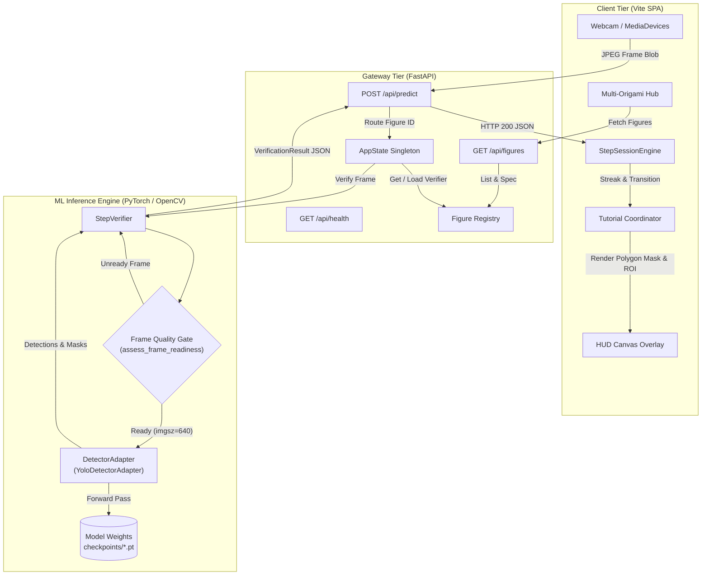
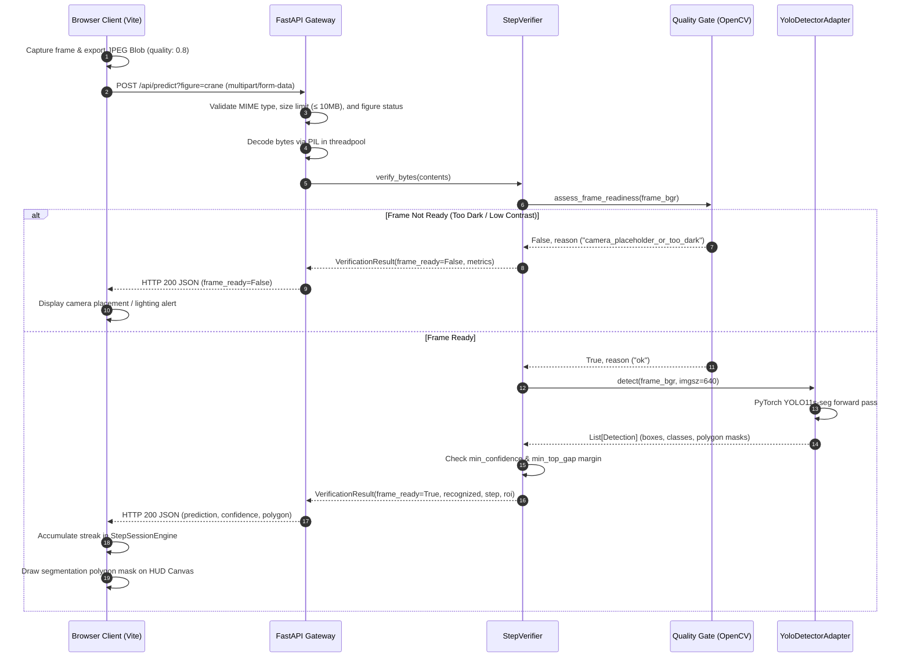
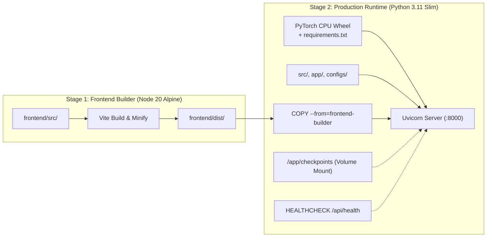

# GamiSenpai Architecture (Senior Developer Guide)

This document outlines the architectural decisions, system design, domain models, and AI pipeline philosophies behind GamiSenpai. It is intended for developers, maintainers, and engineers contributing to the repository.

---

## 1. System Overview (10,000-ft View)

GamiSenpai is a real-time computer vision origami tutoring system designed to operate in a tight feedback loop via a standard web browser. The system is split into three decoupled tiers:

1. **Client Tier (Vite SPA):** Pure TypeScript single-page application managing the high-frequency WebRTC webcam feed, user interaction state, canvas HUD overlays, and audio-visual coaching cues.
2. **Gateway Tier (FastAPI):** An asynchronous REST gateway that handles request validation, streaming payload bounds, dynamic figure routing, and model lifecycle management.
3. **ML Inference Engine (Ultralytics YOLO + Domain Verifier):** A two-tier pipeline consisting of an input quality pre-gate (`assess_frame_readiness`) and an instance segmentation detector (`YoloDetectorAdapter`) governed by `StepVerifier`.

---

## 2. Core Architectural Principles

### 2.1. Vanilla TypeScript over Heavy Virtual-DOM Frameworks
The client UI deliberately eschews virtual-DOM frameworks (React, Vue, Angular). 
- **Reasoning:** Real-time webcam guidance extracts video frames, paints to an off-screen canvas, compresses to JPEG blobs, dispatches HTTP requests, and repaints polygon segmentation masks up to 10–30 times per second. 
- Bypassing virtual-DOM reconciliation eliminates memory churn and garbage-collection frame drops during the interactive loop.

### 2.2. Open-Closed Principle (Dynamic Figure Registry)
Adding a new origami figure (e.g., "Frog", "Samurai Helmet") **requires zero backend code modifications**:
- Figures are defined declaratively as JSON specifications in `configs/figures/*.json`.
- The `FigureRegistry` dynamically scans, parses, validates, and mounts available figure configurations on startup.
- In-memory verifier instances are lazily loaded on first request and cached, with clear cache encapsulation (`clear_verifiers()`).

### 2.3. Two-Tier Verification & Compute Optimization
Processing deep neural networks on unready or irrelevant video frames wastes server compute and produces hallucinated predictions. GamiSenpai implements two distinct gating tiers:
1. **Tier 1 — Camera Readiness Pre-Gate (`assess_frame_readiness`):**
   - Evaluates frame luminance (`CAMERA_READY_MIN_LUMA = 22.0`), dark pixel ratio (`CAMERA_READY_DARK_RATIO = 0.70`), and standard deviation contrast (`CAMERA_READY_MIN_CONTRAST = 6.0`).
   - Immediately intercepts empty frames, covered cameras, or virtual camera placeholder screens (such as Iriun Webcam / OBS waiting screens) in OpenCV/NumPy without invoking PyTorch.
2. **Tier 2 — Instance Segmentation & Margin Verification (`StepVerifier`):**
   - Enforces a minimum confidence threshold (`conf_threshold`, default 55%).
   - Enforces a top-runner-up margin gap (`min_top_gap`, default 8.0 percentage points) to reject ambiguous intermediate folds.
   - Suppresses background false positives via the explicit negative class `Chk0_NonOrigami`.

### 2.4. Zero-Leakage Machine Learning Philosophy
Computer vision models easily overfit to room-specific background artifacts (e.g., desk grain, lighting hue). 
- The dataset construction pipeline (`scripts/dataset/`) enforces **Strict Balanced Session Splitting**.
- Splits are segregated strictly by physical recording session and room environment rather than random frame shuffling, ensuring test metrics reflect genuine real-world fold recognition.

### 2.5. Production Defense in Depth
- **Dedicated Orchestrator Healthcheck (`/api/health`):** Returns HTTP 200 only when default models and registry catalogs are verified, and HTTP 503 during startup or weight absence.
- **Strict Error Boundary Differentiation:** HTTP 400 is strictly reserved for client-side corrupted or invalid image payloads (`UnidentifiedImageError`, `ValueError`), while unexpected internal exceptions return HTTP 500.
- **Production Endpoint Protection:** Registry hot-reloading (`GET /api/figures?reload=true`) is blocked when `APP_ENV=production` with HTTP 403 Forbidden.
- **Resolution Parity:** Standardized on `imgsz=640` across data preparation, model training, offline evaluation, and live inference.

---

## 3. Domain Model & Module Breakdown

### 3.1. Frontend Client (`frontend/src/`)
Compiled via Vite into static assets served directly by FastAPI.

- **`session-engine.ts` (`StepSessionEngine`):**
  - Controls video capture initialization, 720p resolution negotiation, frame extraction, and background prediction dispatching.
  - Implements a leaky-bucket confirmation streak algorithm requiring consecutive positive confirmations before triggering a checkpoint advance.
- **`tutorial-coordinator.ts` (`TutorialCoordinator`):**
  - Manages the Dual-Stage state machine (`watch` mode for video tutorials vs `verify` mode for webcam AI verification).
  - Controls step progression guards (preventing skipping checkpoints), procedural celebratory chime triggers via Web Audio API, and 15-second escape hatch timeouts.
- **`hud-overlay.ts` (`DetectionOverlayRenderer`):**
  - High-performance canvas drawing routines for smooth instance segmentation polygon contours (omitting solid bounding box clutter for clean AR aesthetics).
  - Renders localized friendly coaching labels (`✓ ขั้นตอนที่ X: [ชื่อ]`, `จัดตำแหน่งกระดาษในกล้อง`) inside a glassmorphism pill badge with glowing status dots.
  - Supports developer debug mode toggle (`setShowDebugInfo`) to inspect raw confidence percentages and detection methods without overwhelming regular users.
  - Renders corner viewfinder brackets during fallback bounding box mode.
- **`video-loader.ts` (`VideoStepLoader`):**
  - Manages reference folding video playback, step looping, playback speed regulation (0.5x, 0.75x, 1.0x), and seamless fallback to static PNG reference images upon media absence or network failure.

### 3.2. Gateway Tier (`app/app.py`)
Built with FastAPI and Starlette concurrency utilities.

- **`AppState`:**
  - Encapsulates application state, registry access, and cached verifier instances.
  - Lifecycle managed via FastAPI's `@asynccontextmanager lifespan`.
- **Anti-Cache Middleware (`add_no_cache_headers`):**
  - Injects `Cache-Control: no-cache, no-store, must-revalidate` for root and HTML paths, guaranteeing client browsers never retain stale bundle references after hot redeployments.
- **API Endpoints:**
  | Endpoint | Method | Purpose | Error Codes |
  | :--- | :--- | :--- | :--- |
  | `/api/predict` | `POST` | Upload frame for verification | 400, 404, 413, 500, 503 |
  | `/api/health` | `GET` | Service & model readiness check | 200, 503 |
  | `/api/figures` | `GET` | List available figure summaries | 403 (prod reload) |
  | `/api/figures/{id}` | `GET` | Retrieve complete figure metadata | 404, 422 |
  | `/api/model-info` | `GET` | Inspect active figure and class list | 200 |

### 3.3. ML Inference Engine (`src/`)

- **`src/inference.py` (Core Verifier & Adapters):**
  - `assess_frame_readiness(frame_bgr)`: Evaluates luminance, contrast, and dark ratio against calibrated thresholds.
  - `StepVerifier`: Domain verifier coordinating detector output, multi-class score aggregation, confidence percentage formatting, runner-up gap calculation, and ROI construction.
  - `DetectorAdapter`: Internal interface seam decoupling the domain verifier from concrete ML frameworks.
  - `SyntheticDetectorAdapter`: Deterministic mock detector for high-speed unit testing.
  - `VerificationResult`: Standardized immutable dataclass holding inference outcomes, ROI polygons, and quality telemetry.

- **`src/yolo_verifier.py` (Ultralytics YOLO Integration):**
  - `YoloStepVerifier`: Concrete verifier configuring YOLO instance segmentation models, device assignment (CUDA/CPU), confidence thresholds, and `imgsz=640`.
  - `YoloDetectorAdapter`: Adapts Ultralytics YOLO segmentation output (bounding boxes, class probabilities, and polygon contours) into domain `Detection` objects.

- **`src/figure_registry.py` (`FigureRegistry`):**
  - Reads `configs/figures/*.json` and resolves model artifact paths in `checkpoints/` or `weights/`.
  - Manages in-memory verifier instances with centralized `clear_verifiers()` invalidation.

- **`src/step_config.py` (Domain Constants):**
  - Canonical checkpoint classes for the origami crane: `Chk1` (Square Base) through `Chk6` (Completed Crane), plus `Chk0_NonOrigami`.
  - Step numbering and localization maps.

---

## 4. The Prediction Data Flow

The critical path from browser camera capture to HUD visual feedback completes in under ~100ms in typical GPU environments:

---

## 5. Deployment & Container Architecture

GamiSenpai is packaged as a lightweight, production-hardened container using a **Multi-Stage Docker Build**:

### Key Deployment Characteristics:
1. **Separation of Code and Weights:**
   - Model weights (`.pt` files, ~21.5MB for YOLO11s-seg) are intentionally excluded from git and Docker image layers.
   - Weights are supplied at runtime via container volume mounts (`/app/checkpoints`), enabling zero-rebuild model promotions and rollbacks.
2. **Container Orchestrator Integration:**
   - Docker `HEALTHCHECK` periodically queries `http://localhost:8000/api/health` every 30s.
   - Kubernetes liveness and readiness probes can cleanly isolate container startup from model readiness.
3. **Environment Segregation:**
   - Pre-configured with `APP_ENV=production` by default in the Dockerfile and docker-compose.yml to lock down developer endpoints (e.g., registry force-reload).
   - Configure `CORS_ORIGINS` as a comma-separated list to prevent unauthorized cross-origin requests in production.
