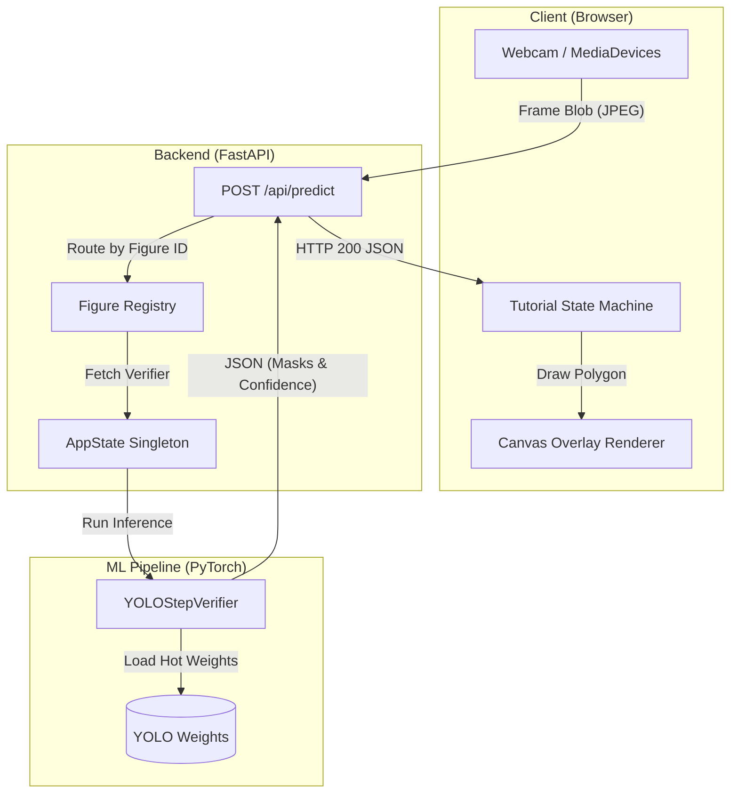
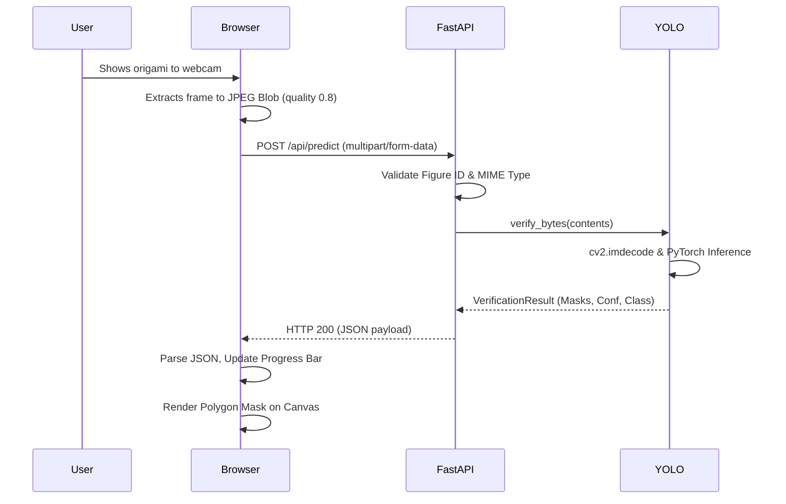

# GamiSenpai Architecture (Senior Developer Guide)

This document outlines the architectural decisions, system design, and AI pipeline philosophies behind GamiSenpai. It is intended for developers, maintainers, and engineers contributing to the repository.

---

## 1. System Overview (10,000-ft View)

GamiSenpai is a real-time computer vision application designed to operate in a tight feedback loop via a standard web browser. The system is split into three highly decoupled domains:

1. **Client (Vite SPA):** Handles webcam capture, state machine (tutorial progression), and rendering inference results (polygon masks) onto a canvas.
2. **API (FastAPI):** A stateless, asynchronous gateway that manages model lifecycles and routes HTTP prediction requests.
3. **ML Engine (Ultralytics YOLO):** The heavy-lifting inference engine running YOLO11s-seg for instance segmentation.

---

## 2. Design Principles

### 2.1. Vanilla TypeScript over Heavy Frameworks
The frontend avoids heavy virtual-DOM frameworks (like React or Vue). Why? 
Real-time webcam inference involves rapidly pulling frames from a `<video>` tag, drawing to a `<canvas>`, converting to a `Blob`, and mutating the DOM overlay up to 30 times a second. Bypassing virtual DOM diffing ensures zero UI stutter during the WebRTC loop.

### 2.2. The Open-Closed Principle (Figure Registry)
Adding a new origami figure (e.g., a "Frog") **requires zero changes to the backend Python code**. 
We use a JSON-driven configuration approach (`configs/figures/*.json`). The `FigureRegistry` dynamically mounts available models and assets on startup.

### 2.3. Zero-Leakage ML Philosophy
Computer Vision models are notoriously lazy; they will learn the background of a room rather than the object if allowed. The entire `scripts/dataset/` pipeline is architected around **Strict Balanced Session Splitting**. We partition data physically by "Room/Environment" rather than randomly shuffling frames, ensuring our Val/Test metrics represent true real-world robustness.

---

## 3. Module Deep Dive

### 3.1. Frontend (`frontend/src/`)
Compiled via Vite into a static bundle served by FastAPI.
- **`session-engine.ts`**: The heartbeat of the application. Manages the `requestAnimationFrame` loop, WebRTC initialization, and HTTP POSTing to the backend.
- **`tutorial-coordinator.ts`**: The UI state machine. It handles the progression logic (e.g., locking the user in Step 1 until the backend returns `Chk1` with `confidence > 0.60`).

### 3.2. Backend API (`app/app.py`)
Built on FastAPI for native asynchronous I/O.
- **`AppState` Module**: Deeply encapsulates the global state. Instead of polluting the module namespace with global variables, `AppState` handles model preloading during FastAPI's `@asynccontextmanager lifespan`.
- **Stateless Inference**: `POST /api/predict` holds no session state. It receives a JPEG, processes it, and dies. This makes horizontal scaling (if deployed to Kubernetes or multiple workers) trivial.

### 3.3. AI Verifier (`src/step_verifier.py`)
An abstract factory pattern is used for models. 
Currently, `YOLOStepVerifier` implements this interface.
- **Instance Segmentation vs. Classification**: We explicitly chose Instance Segmentation (drawing precise masks) over Classification. Classification models suffered from severe *Background Bias* (learning the table instead of the paper).
- **Hard Negative Suppression**: The model is trained with 20% "Background Images" (0-byte labels). This forces the YOLO model to learn what *isn't* origami (keyboards, hands, white tables), virtually eliminating False Positives.

---

## 4. The Prediction Data Flow

The critical path of the application must complete within ~50-100ms for a smooth UX.

---

## 5. Deployment Architecture

The repository is built for **Multi-Stage Docker Deployment**:
1. **Node.js Builder Stage**: Compiles the Vite TypeScript payload into optimized static HTML/JS/CSS assets.
2. **Python Slim Stage**: Installs CPU-optimized PyTorch and FastAPI, copying the Vite assets into a public directory.

**Crucial Note on Weights:** 
Large model weights (`.pt` files) are intentionally `.gitignore`d and excluded from the Docker image to keep the image lightweight (CI/CD friendly). In production, weights are injected into the container via Volume Mounts (`/app/checkpoints`), allowing hot-swapping of models without rebuilding the entire container.
