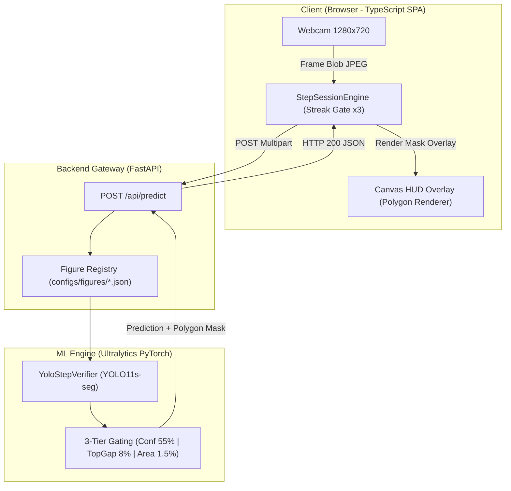

# GamiCheckpoint

Real-time origami folding verification web application powered by YOLO11 Instance Segmentation and FastAPI.

The system guides users through traditional Japanese origami steps via webcam, validating each folding milestone in real time while ignoring hands, clothing, and background clutter.

---

## Quickstart

### 1. Prerequisites
- Python 3.10+ (CUDA GPU recommended for real-time inference)
- Node.js 18+ (optional, only needed if modifying TypeScript frontend)

### 2. Setup Python Environment
```bash
# Clone repository
git clone https://github.com/Puwizz/GamiSenpai.git
cd GamiSenpai

# Create and activate virtual environment
python -m venv .venv

# On Windows (PowerShell):
.\.venv\Scripts\Activate.ps1
# On macOS / Linux:
source .venv/bin/activate

# Install dependencies
pip install -r requirements.txt
```

### 3. Model Weights
Place the trained YOLO11s-seg weights at:
```text
checkpoints/yolo_runs/origami_yolo_run11_yolo11s-seg_v3_bg/weights/best.pt
```

### 4. Run the Server
```bash
# Windows PowerShell
.\start_server.ps1

# Or run Uvicorn directly
python -m uvicorn app.app:app --host 127.0.0.1 --port 8000 --ws none --reload
```
Open **`http://localhost:8000`** in your browser.

---

## System Architecture



### Verification & Gating Logic
- **Two-Tier Thresholding:**
  - **Detector Gating (55%):** Filters out non-origami objects (clothes, furniture, hands). Anything below 55% is marked unrecognized.
  - **Ambiguity Gating (`top_gap` >= 8%):** If the difference between the top prediction and runner-up class is under 8%, the frame is flagged as ambiguous and rejected.
  - **Area Ratio Filter (`min_area_ratio` >= 1.5%):** Suppresses tiny spurious background noise.
- **Streak Filter:** Requires 3 consecutive consistent prediction frames (`MATCH_STREAK_REQUIRED = 3`) before unlocking the next milestone.

---

## Model Benchmark (Run 11 SOTA — Pre-Augmented + Background-Hardened)

The production model is **YOLO11s-seg (Run 11)** trained on the versioned dataset `data/origami_seg_v3_bg_balanced/` (4,281 unique images: 3,648 train, 356 val, 279 test) combining **Pre-Augmented multi-angle origami data (3,296 images)** with **352 authentic hard-negative background images (9.65% in Train)**, audited for **Zero Data Leakage** across physical sessions, videos, and MD5 hashes.

### 1. Milestone Segmentation Performance (Unseen Test Set: `session_006` Glossy Floor Tiles)

| Milestone | Target Class | Mask mAP50 | Mask mAP50-95 | Precision | Recall |
|---|---|:---:|:---:|:---:|:---:|
| Step 1 | Chk1 (Square Base) | **99.5%** | 96.6% | 98.8% | 100.0% |
| Step 2 | Chk2 (Kite Folds) | **94.1%** | 85.5% | 89.8% | 82.8% |
| Step 3 | Chk3 (Bird Base Prep) | **99.5%** | 94.2% | 100.0% | 96.6% |
| Step 4 | Chk4 (Bird Base / Neck & Tail) | **91.8%** | 79.7% | 89.5% | 77.8% |
| Step 5 | Chk5 (Head Fold) | **87.4%** | 72.4% | 77.9% | 86.7% |
| Step 6 | Chk6 (Completed Crane) | **88.5%** | 79.0% | 90.0% | 88.2% |
| **Overall (Test)** | **session_006 Floor** | **`93.4%`** | **`84.6%`** | **`91.0%`** | **`88.7%`** |
| **Overall (Val)** | **session_004 Bedroom** | **`91.5%`** | **`85.9%`** | **`91.4%`** | **`80.1%`** |

- **All-Time SOTA Mask Performance:** Overall Test Mask mAP50 reached **93.4%** (+1.0% over Run 10) and Mask mAP50-95 reached **84.6%** (+13.3% higher than Run 9 baseline).
- **Major Breakthrough on Step 5 (Head Fold):** Test mAP50 for Chk5 surged from 77.2% to **87.4% (+10.2%)** due to pre-augmented training diversity resolving fine-grained fold ambiguities.
- **Inference Speed:** **7.9 ms per frame (~125 FPS)** on NVIDIA GeForce RTX 5050 Laptop GPU (640x640 resolution).

### 2. Hard-Negative False-Positive Suppression Benchmark

Tested against 217 authentic hard-negative clutter frames (white laptop keyboard stickers, keys, bed clothing, fans, floor clutter):

| Test Condition | Metric Result | Engineering Interpretation |
|---|:---:|---|
| **Max Negative Conf Observed** | **15.04%** | Safely far below the 55% application gating threshold |
| **Clean Suppression Rate (Conf >= 0.25)** | **100.00%** (0 / 217) | Zero spurious bounding boxes at low confidence |
| **Clean Suppression Rate (Conf >= 0.50)** | **100.00%** (0 / 217) | 100% immune to false checkpoint activations in real usage |

### 3. Empirical Evidence & Benchmark Artifacts

All empirical logs, evaluation reports, raw metrics, and training diagnostics are preserved under `docs/`:
- **Comprehensive Benchmark Report:** [`docs/ORIGAMI_YOLO_RUN11_YOLO11S-SEG_V3_BG_BENCHMARK_REPORT.md`](docs/ORIGAMI_YOLO_RUN11_YOLO11S-SEG_V3_BG_BENCHMARK_REPORT.md)
- **Raw Evaluation Metrics JSON:** [`docs/origami_yolo_run11_yolo11s-seg_v3_bg_metrics.json`](docs/origami_yolo_run11_yolo11s-seg_v3_bg_metrics.json)
- **Zero-Leakage Session Audit History:** [`docs/DATASET_SPLIT_AND_LEAKAGE_HISTORY.md`](docs/DATASET_SPLIT_AND_LEAKAGE_HISTORY.md)
- **Training Diagnostics & Visual Curves:**
  - [Normalized Confusion Matrix](docs/assets/confusion_matrix_normalized.png)
  - [Training Metrics & Loss Curves (50 Epochs)](docs/assets/results.png)
  - [Mask Precision-Recall Curve](docs/assets/MaskPR_curve.png)
  - [Sample Milestone Validation Predictions](docs/assets/val_batch0_pred.jpg)

---

## Operational Scope & Out-of-Distribution Defense

- **Background Hardening:** Built-in negative-class supervision (0-byte labels) ensures the model penalizes non-origami objects (stickers, keyboards, mousepads, household clutter) down to $\le 10\%$ confidence.
- **Out-of-Distribution Safeguards:**
  1. **Global Confidence Gating (55%):** Suppresses low-confidence background artifacts directly at the verifier layer.
  2. **Ambiguity Gating (`top_gap` >= 8%):** Prevents confused multi-class boundaries.
  3. **Sequential Step Lock:** Strict state-machine progression requiring the current milestone to be confirmed before unlocking subsequent steps.

---

## Adding New Figures

The backend dynamically registers all `.json` figure definitions from `configs/figures/` on startup. To add a new origami model, create a corresponding figure definition file (e.g., `frog.json`) specifying step milestones, target class labels, confidence thresholds, and model checkpoint path.

## Testing

```bash
# Run backend pytest suite (API, verifier, gating contracts)
pytest tests/ -v

# Run frontend tests and type checks (optional)
cd frontend
npm install
npm run typecheck
npm test
```

---

## Project Structure

```text
GamiSenpai/
├── app/                  # FastAPI web application
│   ├── app.py            # API routes (/api/figures, /api/predict)
│   └── static/           # SPA HTML, CSS, JavaScript bundle, tutorial videos
├── configs/              # Configurations
│   ├── figures/          # Origami figure definitions (crane.json, frog.json)
│   └── *.yaml            # YOLO dataset training configs
├── frontend/             # TypeScript source code (Vite build)
│   └── src/              # Session engine, camera adapter, canvas HUD
├── src/                  # Core computer vision & verifier engine
│   ├── figure_registry.py # Dynamic figure definition registry & in-memory cache
│   ├── yolo_verifier.py  # YOLO11s-seg adapter and ambiguity gating
│   └── step_config.py    # Canonical step and class definitions
├── scripts/              # Automation and training scripts
│   ├── yolo/split_*.py   # Session-split dataset generators (Zero-Leakage audit)
│   └── yolo/train_*.py   # YOLO training runners (Windows CUDA stable)
├── checkpoints/          # Model weights directory (git-ignored)
└── tests/                # Automated pytest unit test suite
```

---

## License & Affiliation

Department of Applied Computer Science (ACS), King Mongkut's University of Technology Thonburi (KMUTT).
