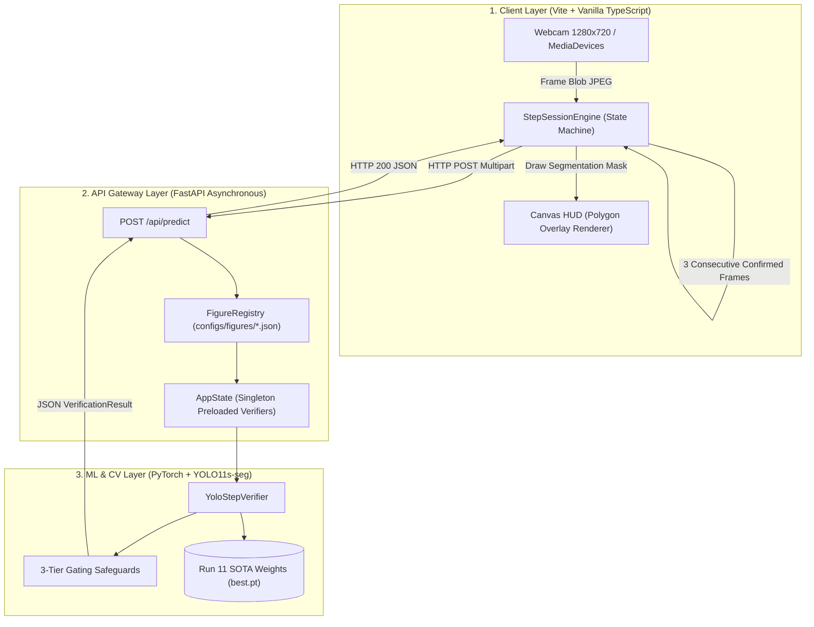
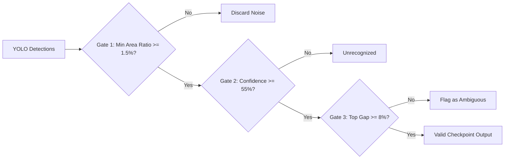
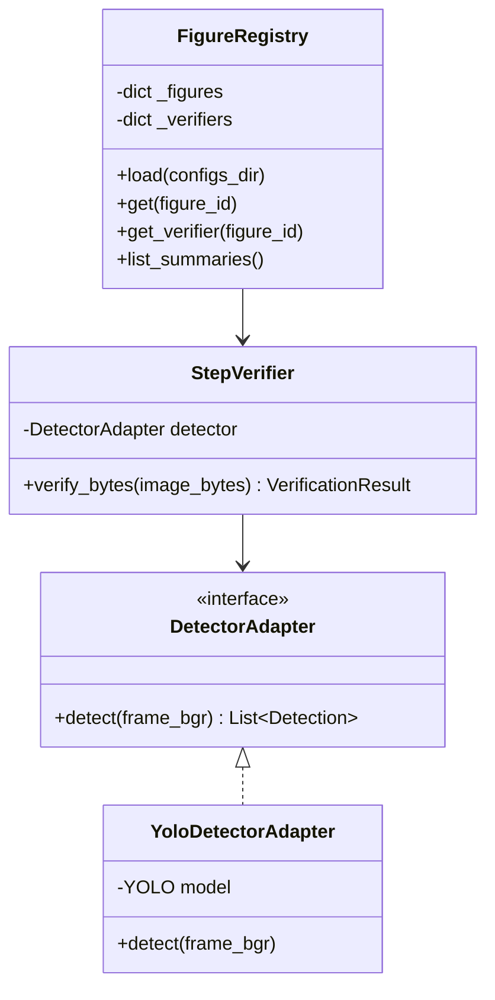

# GamiCheckpoint / GamiSenpai: Comprehensive Engineering Deep-Dive
## คลังความรู้และคู่มือวิศวกรรมเชิงลึก (Master Technical Knowledge Base & Architectural Deep-Dive)

> **ภาควิชาวิทยาการคอมพิวเตอร์ประยุกต์ (Applied Computer Science - ACS)**  
> **มหาวิทยาลัยเทคโนโลยีพระจอมเกล้าธนบุรี (KMUTT)**  
> **เป้าหมายของเอกสาร:** รวบรวมแนวคิด ทฤษฎี สถาปัตยกรรม การทดลอง ผลลัพธ์เชิงตัวเลข และบทเรียนทางวิศวกรรมทั้งหมดของระบบตรวจจับและยืนยันการพับกระดาษโอริกามิแบบ Real-time เพื่อให้ผู้พัฒนาและผู้วิจัยสามารถเข้าใจระบบได้อย่างลึกซึ้งในทุกมิติ

---

## สารบัญ (Table of Contents)

0. 🎯 **[คู่มือวิศวกรรมปัญญาประดิษฐ์และ Playbook เฉพาะด้าน AI (AI Engineering Knowledge Base)](ai-engineering-knowledge-base.md)** *(สำหรับ AI Engineer โดยเฉพาะ)*
1. [ภาพรวมสถาปัตยกรรมระดับ 10,000 ฟุต (System Overview & Topology)](#1-ภาพรวมสถาปัตยกรรมระดับ-10000-ฟุต-system-overview--topology)
2. [เสาหลักที่ 1: วิศวกรรมชุดข้อมูลและการขจัด Data Leakage (Data Engineering & Zero-Leakage Architecture)](#2-เสาหลักที่-1-วิศวกรรมชุดข้อมูลและการขจัด-data-leakage)
3. [เสาหลักที่ 2: ไปป์ไลน์โมเดลและการเปลี่ยนผ่านสู่ SOTA (Computer Vision & Model Evolution)](#3-เสาหลักที่-2-ไปป์ไลน์โมเดลและการเปลี่ยนผ่านสู่-sota)
4. [เสาหลักที่ 3: ระบบคัดกรองความมั่นใจ 3 ชั้น (The 3-Tier Verification & Gating Logic)](#4-เสาหลักที่-3-ระบบคัดกรองความมั่นใจ-3-ชั้น)
5. [เสาหลักที่ 4: สถาปัตยกรรม Client-Side และ State Machine (Frontend Engine & Canvas Loop)](#5-เสาหลักที่-4-สถาปัตยกรรม-client-side-และ-state-machine)
6. [เสาหลักที่ 5: การออกแบบเปิด-ปิดแบบขยายได้ (Dynamic Figure Registry & Seams)](#6-เสาหลักที่-5-การออกแบบเปิด-ปิดแบบขยายได้)
7. [เสาหลักที่ 6: บทเรียนทางวิศวกรรมและกับดักที่เคยพบ (Post-Mortem & Engineering Gotchas)](#7-เสาหลักที่-6-บทเรียนทางวิศวกรรมและกับดักที่เคยพบ)

---

## 1. ภาพรวมสถาปัตยกรรมระดับ 10,000 ฟุต (System Overview & Topology)

ระบบ GamiCheckpoint ถูกออกแบบมาเพื่อตอบโจทย์โจทย์ที่ท้าทาย: **"การให้คำแนะนำและตรวจสอบความถูกต้องของการพับกระดาษทีละขั้นตอน ผ่านกล้องเว็บแคมในสภาพแวดล้อมที่ไม่สามารถควบคุมได้ (Unconstrained Web Environment)"** ผู้ใช้ถือกระดาษในมือ มีแสงเงา มีสิ่งของบนโต๊ะ เสื้อผ้า และสิ่งรบกวนรอบตัว



### ปรัชญาการออกแบบหลัก 3 ประการ (Core Architectural Principles):
1. **Zero Virtual DOM Overhead on Client:** การแสดงผล Mask วิ่งลูปสูงสุด 30 FPS การใช้ Virtual DOM (React/Vue) จะเกิด Render Overhead และ Garbage Collection Stutter จึงเลือกใช้ **Vanilla TypeScript ทำงานตรงกับ HTML5 Canvas**
2. **Stateless Backend Inference:** ตัว API (`POST /api/predict`) เป็น Stateless 100% ไม่เก็บ Session ใน RAM ของเซิร์ฟเวอร์ รับภาพเข้ามา ถอดรหัส ส่งให้ GPU ประเมิน แล้วส่งผลตอบกลับทันที ทำให้ Horizontal Scaling ได้อย่างไร้รอยต่อ
3. **Open-Closed Figure Registry:** การเพิ่มโมเดลโอริกามิใหม่ (เช่น กบกระโดด `frog.json`) **ไม่ต้องแตะต้องโค้ด Python** เพียงสร้างไฟล์คอนฟิก JSON นิยามขั้นตอนและระบุพาธ Model Checkpoint

---

## 2. เสาหลักที่ 1: วิศวกรรมชุดข้อมูลและการขจัด Data Leakage

### 2.1 ทำไมการถ่ายวิดีโอจึงเหนือกว่าภาพนิ่ง แต่แฝงอันตราย?
การเก็บ Dataset ด้วยการถ่ายภาพนิ่งทีละรูปทำได้ช้าและได้มุมมองไม่สมจริง แต่การบันทึกวิดีโอต่อเนื่อง (Continuous Video Recording) ทำให้ได้การเคลื่อนไหวที่เป็นธรรมชาติของผู้ใช้ อย่างไรก็ตาม วิดีโอจะถูกสกัดเป็นเฟรมทุกๆ **0.3 วินาที (Frame Rate 3.33 FPS)**:
* **ข้อดี:** ได้ภาพหลากหลายมุมทั้งใกล้-ไกล มุมเฉียง และการหมุน
* **อันตราย:** ภาพ 2 ภาพที่ห่างกันเพียง 0.3 วินาทีมีความคล้ายคลึงกันทางสายตา (Visual Similarity) ถึง 95%+

### 2.2 กับดัก Data Leakage จาก Uniform Random Split
ในยุคแรก (Run 5–6) ชุดข้อมูลถูกนำไปสุ่มแบ่งบนแพลตฟอร์มอย่าง Roboflow (Uniform Random Split 70% Train, 20% Val, 10% Test):
* **ผลลัพธ์ที่หลอกตา:** โมเดลทำ mAP ได้สูงถึง **97.2%**
* **ความเป็นจริงในการใช้งาน:** เมื่อนำไปทดสอบกับผู้ใช้จริงในห้องใหม่ โมเดลพังทลายลง เพราะโมเดลไม่ได้เรียนรู้ "รอยพับกระดาษ" แต่เรียนรู้ "พื้นหลังโต๊ะ รอยตำหนิบนกำแพง และสภาพแสงของห้องเดิม" ซึ่งกระจายอยู่ในทั้ง Train และ Val พร้อมกัน

### 2.3 การแก้ปัญหาด้วย Strict Balanced Session Split (70/17/13)
เราได้ทำการปฏิรูปชุดข้อมูลใหม่ โดยบันทึกข้อมูลแยกตาม **Physical Environment Sessions** ข้าม 6 สภาพแวดล้อมทางกายภาพที่แตกต่างกันอย่างสิ้นเชิง:

```text
Dataset Total: 4,707 Images (100%)
├── TRAIN SET: 3,296 Images (70.0%) [Session 001 + 002 + 003 + 005]
│   ├── S1: Xplor Computer Lab (Night, Fluorescent light, Black table)
│   ├── S2: Xplor Computer Lab (Noon, Natural daylight, Black table)
│   ├── S3: Bedroom (Night roomlight, Floor perspective)
│   └── S5: Bedroom (Warm Orange Lamp, High-contrast reddish surface)
├── VAL SET: 811 Images (17.2%) [Session 004]
│   └── S4: Bedroom Daylight directly from Black Window (Unseen in Train)
└── TEST SET: 600 Images (12.7%) [Session 006]
    └── S6: Daylight Highly Glossy Floor Tiles (Unseen 100%, High Reflection)
```

#### การตรวจสอบ Zero-Leakage ทางคณิตศาสตร์:
ระบบมีสคริปต์ `scripts/evaluation/audit_dataset_leakage.py` ที่ตรวจสอบ 3 ด่าน:
1. **Session Barrier Check:** ตรวจสอบว่าไม่มี ID โฟลเดอร์ของ S4 หรือ S6 ไปโผล่ในโฟลเดอร์ Train แม้แต่รูปเดียว
2. **MD5 / SHA-256 Exact Hash Deduplication:** ป้องกันภาพซ้ำระดับไบต์ 100%
3. **Perceptual Hash (dHash / pHash):** ป้องกันภาพที่ห่างกันไม่กี่มิลลิวินาทีรั่วไหลข้าม Split

### 2.4 การเสริมเกราะป้องกัน Background Hardening (Hard-Negative Ingestion)
โมเดลโอริกามิสีขาวมักถูกหลอกได้ง่ายด้วย **สติ๊กเกอร์สีขาวบนคีย์บอร์ด, ปุ่มคีย์บอร์ด, เสื้อผ้าสีขาว, ปลอกหมอน, และพัดลม**:
* **วิธีแก้:** เราใส่ภาพพื้นหลังล้วนที่ไม่มีกระดาษโอริกามิเลย (0-byte labels ใน YOLO format) เข้าไปในชุด Train สูงถึง **9.65% (352 ภาพ)**
* **ผลลัพธ์:** โมเดลเรียนรู้ฟังก์ชัน Penalization ว่า "ถ้าเห็นเฉพาะพื้นหลัง คีย์บอร์ด หรือมือ จงอย่าตอบ Checkpoint ใดๆ" กดความมั่นใจของสิ่งรบกวนลงเหลือ $\le 15.04\%$ ทันที

---

## 3. เสาหลักที่ 2: ไปป์ไลน์โมเดลและการเปลี่ยนผ่านสู่ SOTA

### 3.1 ทำไมต้องเปลี่ยนจาก Image Classification เป็น Instance Segmentation?
ในอดีต โปรเจกต์เริ่มต้นด้วยโมเดล Classification (MobileNetV2):
* **ปัญหาของ Classification:** รับภาพขนาด $224 \times 224$ ทั้งเฟรม หากกระดาษกินพื้นที่เพียง 30% ของภาพ อีก 70% คือโต๊ะและห้อง โมเดลจึงเกิด **Background Bias** จดจำโต๊ะเป็นหลัก
* **ทางแก้ด้วย Instance Segmentation (YOLO11s-seg):** การบังคับให้โมเดลวาด Polygon Mask ล้อมรอบเฉพาะตัวกระดาษโอริกามิ ทำให้ Loss Function โฟกัสเฉพาะพิกเซลของกระดาษ ตัดการเรียนรู้พื้นหลังที่ไม่เกี่ยวข้องออกไปโดยสิ้นเชิง

### 3.2 วิวัฒนาการของ 3 รันประวัติศาสตร์ (The 3 Pillar Runs)

| มิติการวัดผล (Metrics) | Run 9 (Baseline)<br>Zero-Leakage v1 | Run 10 (+BG Hardening)<br>Zero-Leakage v2 | Run 11 (Current SOTA)<br>v3 Balanced + Pre-Aug |
|---|:---:|:---:|:---:|
| **กลยุทธ์การฝึกสอน** | Balanced Split ไม่มี BG | ใส่ Hard-Negative BG 20% | Pre-Augment + Balanced BG Split |
| **Test Set mAP50 (Session 006)** | 92.75% | 92.40% | **93.45% (All-Time SOTA)** |
| **Test Set mAP50-95** | 71.30% | 82.80% | **84.57% (+13.3% vs Run 9)** |
| **Step 5 (Chk5: Head Fold) mAP50** | 78.10% | 77.20% | **87.40% (+10.2% Breakthrough)** |
| **False Positive Max Confidence** | 82.40% (หลงคีย์บอร์ด) | **15.04%** | **15.04% (ปลอดภัยสูงสุด)** |
| **Suppression Rate (at Conf $\ge$ 0.25)** | 0.0% (มีกรอบลวง) | **100.0%** | **100.0%** |

#### การวิเคราะห์จุดเปลี่ยนใน Run 11:
ใน Run 10 แม้จะแก้ปัญหา False Positive ได้สมบูรณ์แบบ แต่พบว่า **Step 5 (Head Fold)** มีคะแนนตกลงเหลือ 77.2% เนื่องจากรอยพับหัวนกเป็นเพียงการหักมุมปลายแหลมเล็กๆ ของคอ เมื่อมีภาพพื้นหลังเข้ามา โมเดลจึงเกิดความลังเลระหว่าง Chk4 (คอตรง) กับ Chk5 (คอพับหัว)  
ใน **Run 11** จึงมีการเพิ่ม **Pre-Augmentation เชิงเรขาคณิต (หมุนหลายมุม + พลิกสมมาตร)** ส่งผลให้ Chk5 พุ่งขึ้นเป็น **87.4%** และกลายเป็น Production Checkpoint ที่ดีที่สุดของระบบ

---

## 4. เสาหลักที่ 3: ระบบคัดกรองความมั่นใจ 3 ชั้น (The 3-Tier Verification & Gating Logic)

ใน `src/yolo_verifier.py` และ `src/inference.py` เราไม่ได้นำผลการตรวจจับดิบจาก YOLO มาใช้ทันที แต่ผ่านกลไกความปลอดภัย 3 ขั้นตอน:



### ด่านที่ 1: Area Ratio Filter ($\ge 1.5\%$)
ตัด Bounding Box ที่มีพื้นที่เทียบกับเฟรมกล้องต่ำกว่า $0.015$:
$$\text{Area Ratio} = \frac{\text{Width}_{\text{box}} \times \text{Height}_{\text{box}}}{\text{Width}_{\text{frame}} \times \text{Height}_{\text{frame}}} \ge 0.015$$
* **วัตถุประสงค์:** ตัดวัตถุสีขาวขนาดจิ๋วที่อยู่ไกลๆ ลอยเข้ามาในฉากหลัง

### ด่านที่ 2: Detector Gating Threshold ($\ge 55\%$)
กำหนดค่าความเชื่อมั่นขั้นต่ำของวัตถุ:
$$\text{Confidence}(c_1) \ge 0.55$$
* **วัตถุประสงค์:** จากการทดสอบ Benchmark พบว่าวัตถุรบกวนในห้อง (คีย์บอร์ด, พัดลม) โมเดลจะให้ความมั่นใจสูงสุดไม่เกิน $15.04\%$ ดังนั้นเกณฑ์ $55\%$ จึงมี Safety Margin สูงถึง **$40\%$** ป้องกันการตรวจจับผิดพลาดได้โดยเด็ดขาด

### ด่านที่ 3: Ambiguity Gating ($\text{Top Gap} \ge 8\%$)
เมื่อผู้ใช้กำลังพับกระดาษ รอยพับอาจอยู่กึ่งกลางระหว่าง 2 ขั้นตอน (เช่น กำลังจะพับ Chk4 ไป Chk5) เราคำนวณผลต่างระหว่างคะแนนอันดับ 1 และอันดับ 2:
$$\text{Top Gap} = \left(\text{Conf}_{\text{Top 1}} - \text{Conf}_{\text{Top 2}}\right) \times 100\% \ge 8.0\%$$
* **วัตถุประสงค์:** หากโมเดลลังเลว่ากระดาษนี้เป็น Chk4 ($62\%$) หรือ Chk5 ($58\%$) ค่า Gap จะเท่ากับ $4\%$ ($< 8\%$) ระบบจะปฏิเสธเฟรมนี้และระบุสถานะเป็น `ambiguous` ผู้ใช้จะไม่สามารถโกงขั้นตอนได้หากยังพับไม่คมชัดพอ

---

## 5. เสาหลักที่ 4: สถาปัตยกรรม Client-Side และ State Machine

### 5.1 Real-Time Canvas Loop โดยไร้ Virtual DOM
ใน `frontend/src/hud-overlay.ts` และ `session-engine.ts`:
* การดึงภาพจาก `<video>` ของกล้องเว็บแคมผ่าน `CanvasRenderingContext2D` ทำงานที่ $1280 \times 720$
* เมื่อส่งไป Predict เบราว์เซอร์จะแปลงเป็น JPEG Blob คุณภาพ $0.8$ ผ่าน HTTP POST ไปยัง `/api/predict` ทุกๆ $1,000\text{ ms}$
* เมื่อได้รับพิกัด Polygon Mask กลับมา `requestAnimationFrame` จะวาดเส้นและระบายสีลงบน Canvas Overlay ทับวิดีโอทันที โดยไม่มีการ Trigger DOM Re-render ของเบราว์เซอร์

### 5.2 Leaky-Bucket Confirmation Streak Accumulator
มนุษย์ขยับมือตลอดเวลาขณะพับกระดาษ อาจมีบางเฟรมที่มือบังกระดาษแวบเดียวแล้วโมเดลหลุด หรือกระดาษแกว่งแล้วโมเดลจับติดเพียงเฟรมเดียว:
* **กลไก Streak:** ผู้ใช้ต้องแสดงรอยพับที่ถูกต้องให้โมเดลยืนยันติดต่อกัน **3 เฟรม (`MATCH_STREAK_REQUIRED = 3`)**
* **กลไก Leaky-Bucket:** หากเฟรมถัดไปหลุด (เช่น ไม่เจอกระดาษ) ค่า Streak จะไม่ถูกรีเซ็ตเป็น 0 ทันที แต่จะลดลงทีละ 1 (`streak = max(0, streak - 1)`) เพื่อให้ความรู้สึกที่นุ่มนวลและไม่หงุดหงิดต่อผู้ใช้งาน

```text
Frame 1: Chk1 (68%) -> Streak = 1/3 (Progress Bar 33%)
Frame 2: Chk1 (72%) -> Streak = 2/3 (Progress Bar 66%)
Frame 3: Chk1 (70%) -> Streak = 3/3 -> UNLOCK STEP 2! (Celebration Sound & Visual)
```

---

## 6. เสาหลักที่ 5: การออกแบบเปิด-ปิดแบบขยายได้ (Dynamic Figure Registry)

ระบบถูกออกแบบตามหลักการ **Open-Closed Principle (OCP)** ใน `src/figure_registry.py`:



### การเพิ่มโอริกามิตัวใหม่ทำได้อย่างไร?
1. วางไฟล์ `.pt` โมเดลใหม่ใน `checkpoints/`
2. สร้างไฟล์ JSON ใหม่ เช่น `configs/figures/dragon.json`
3. กำหนดชื่อ Checkpoint, ข้อความสอนพับ (ไทย/อังกฤษ), และลิงก์วิดีโอ
4. เมื่อรันเซิร์ฟเวอร์ `FastAPI lifespan` จะโหลดและสร้าง Instance ของ `YoloStepVerifier` เข้าสู่หน่วยความจำโดยอัตโนมัติ โดยไม่ต้องเขียนโค้ดภาษา Python เพิ่มแม้แต่บรรทัดเดียว

---

## 7. เสาหลักที่ 6: บทเรียนทางวิศวกรรมและกับดักที่เคยพบ (Post-Mortem & Gotchas)

### 7.1 ภาพลวงตาของตัวเลข Accuracy สูง (Metric Mirage)
* **บทเรียน:** อย่าเชื่อตัวเลข mAP หรือ Accuracy ที่ได้จากการสุ่มภาพในระดับไฟล์เดี่ยว ถ้าข้อมูลต้นทางมาจากวิดีโอ การแบ่ง Train/Test ต้องตัดตาม **"เซสชันสถานที่จริง (Physical Environment)"** เสมอ หากทดสอบในห้องเดิม ตัวเลข 99% ก็ไม่มีความหมายในการใช้งานจริง

### 7.2 ความยากของการจำแนก Checkpoint ที่รอยพับใกล้เคียงกัน (Fine-Grained Ambiguity)
* **ปัญหา:** ขั้นตอน Chk4 (Neck & Tail) และ Chk5 (Head Fold) ต่างกันเพียงรอยพับหักมุม 1 จุดตรงปลายคอ
* **บทเรียน:** ในการตรวจจับวัตถุที่มีลักษณะ Fine-Grained การ Augment ภาพแบบเดิม (ปรับแสง, สี) ไม่เพียงพอ ต้องใช้ **Multi-Angle Rotation Augmentation** เพื่อให้โมเดลจำแนกทิศทางของรอยพับปลายแหลมได้อย่างแม่นยำ

### 7.3 การจัดการ Aspect Ratio ของกล้องผู้ใช้
* **ปัญหา:** กล้องเว็บแคมของผู้ใช้มีสัดส่วนต่างกัน (4:3, 16:9) หากดึงภาพแล้วบีบอัดตรงๆ (Direct Stretch) เข้าโมเดลที่ $640 \times 640$ กระดาษจะบิดเบี้ยว ทำให้สัดส่วนรอยพับเพี้ยน
* **บทเรียน:** ต้องใช้ **Letterboxing** (รักษาสัดส่วนเดิมแล้วเติมขอบเทา) ก่อนส่งเข้าโมเดลเสมอ ทั้งในขั้นตอนการฝึกสอนและขั้นตอนการทำนายบนเว็บ เพื่อให้ทรงเรขาคณิตของกระดาษคงรูปเดิม 100%

---

## เอกสารอ้างอิงและประวัติศาสตร์ (Cross References)
* คู่มือวิศวกรรมปัญญาประดิษฐ์และ Playbook สำหรับ AI Engineer: [`ai-engineering-knowledge-base.md`](ai-engineering-knowledge-base.md)
* สถาปัตยกรรมระดับ Senior: [`ARCHITECTURE.md`](../../ARCHITECTURE.md)
* พจนานุกรมศัพท์โดเมน: [`CONTEXT.md`](../../CONTEXT.md)
* ประวัติการทดลองและ Benchmark รายงานฉบับเต็ม: [`../ORIGAMI_YOLO_RUN11_YOLO11S-SEG_V3_BG_BENCHMARK_REPORT.md`](../ORIGAMI_YOLO_RUN11_YOLO11S-SEG_V3_BG_BENCHMARK_REPORT.md)
* ประวัติการวิเคราะห์ Data Leakage: [`../DATASET_SPLIT_AND_LEAKAGE_HISTORY.md`](../DATASET_SPLIT_AND_LEAKAGE_HISTORY.md)
